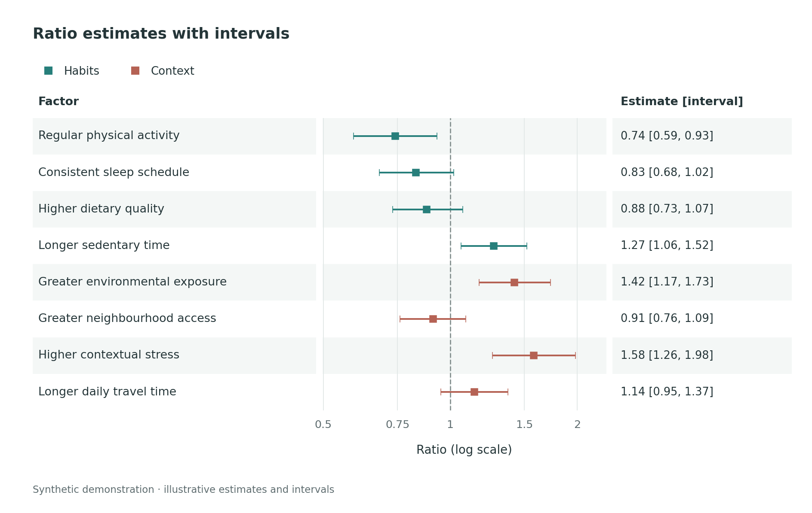
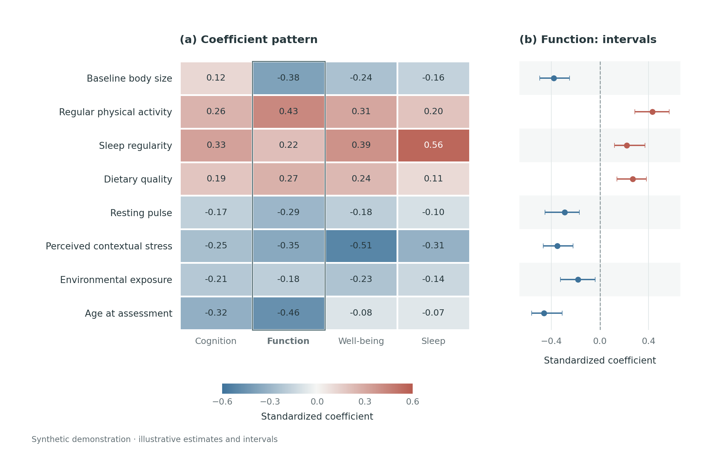

# Personal Scientific Figure Library

收藏值得反复使用的科研图，把它们沉淀成有原图、有代码、有样式参数、有验证记录的绘图条目。

你只需要做两件事：遇到喜欢的图时交给 agent；需要作图时指定想使用的图表 ID。来源可以是论文截图、自己的成图、PDF 中的一页，也可以附带原始代码和数据。

当前版本 v0.3.0：普通 GitHub 仓库，不需要安装 skill，没有模型 API 或自动全库检索。包含中文工作规约、命令工具、两个可运行示例，以及部署在 GitHub Pages 上的图库网页（浏览、筛选、调色实验、拼板、一键复制给 agent 的指令）。

## 最先看什么

| 你想做的事 | 入口 |
|---|---|
| 告诉 agent“这张图收进图库” | 已安装的 `figure-collect` skill 自动走完收录→复现→验证→推送；见 [skill 说明](skills/figure-collect/SKILL.md) |
| 手动让 agent 收录并尽量还原 | [收录与复现提示词](prompts/01-collect-and-reproduce.md) |
| 指定某张图，用自己的新数据作图 | [按 ID 复用提示词](prompts/02-reuse-by-id.md) |
| 调整已经入库的配色、布局或代码 | [条目修改提示词](prompts/03-refine-entry.md) |
| 理解本次为什么这样设计 | [仓库架构与取舍](docs/architecture.md) |
| 让 agent 做得更像原图 | [复现与验收指南](docs/reproduction-guide.md) |
| 浏览收藏 | [图库网页](https://fxt-gw-pb.github.io/personal-scientific-figure-library/)；本地管理视图 `python scripts/figurelib.py site --local --serve` |
| 查看 Markdown 目录 | [收藏目录](catalog/GALLERY.md)；当前正式收藏为空 |
| 调整或扩展网页 | [网页使用、发布与扩展](docs/website.md) |

完整旧包中没有正式图表条目，因此本次没有需要迁移的收藏。两个示例使用合成数据，只演示这套工程如何工作，不代表你已经收藏过它们。

## 以后就这样使用

### 收录并复现

把仓库放进 agent 可访问的工作区，附上图和已有材料，然后说：

> 把这张图加入我的科研图库，ID 用 `paper-forest-01`。我喜欢它的配色、左侧标签和置信区间布局。请先查看原图及附件，再尽量还原；没有原始数据的部分明确标记。实际运行并查看结果后，保存样式、代码、数据格式、对照图和差异说明，最后更新目录。

如果只有图、没有链接或数据，也可以开始。不知道的来源字段留空；后续找到材料再补。CLI 负责建目录、复制原件、执行明确指定的脚本和校验记录；视觉理解与复现代码由你正在使用的 agent 完成。

### 用指定条目作图

> 使用图库中的 `paper-forest-01`，保留它的颜色、面板比例和标注方式，用我这次的数据作图。先看这一个条目的预览、样式和输入格式，再做必要适配。结果放进我当前研究项目，不覆盖图库内的复现结果。

这一步不需要搜索全库。`show ID`、`context ID`、`render ID`、`validate ID` 都直接定位该 ID。只有你要求选图、浏览或重建目录时才读取多个条目。

如果新研究中的 agent 无法读取整个仓库，可以导出一个独立目录：

```bash
python scripts/figurelib.py bundle forest-ci --out workspace/forest-recipe
```

把该目录交给 agent 即可。目录包含该条目的材料与 `AGENT_BRIEF.md`；它也可能包含原始参考材料，适合你自己的研究环境。

## 五分钟跑通

建议 Python 3.12；本次在 Python 3.12.14 实际验证。核心工具需要 PyYAML、jsonschema、Pillow；演示绘图另用 Matplotlib、NumPy，直接依赖版本已固定。示例的 NumPy 版本要求 Python 3.11 或更高。

在解压后的仓库根目录运行：

```bash
python3 -m venv .venv
source .venv/bin/activate
python -m pip install -r requirements-examples.txt
python scripts/figurelib.py validate --include-examples
python scripts/figurelib.py show forest-ci
python scripts/figurelib.py render forest-ci --out workspace/first-forest
```

打开 `workspace/first-forest/figure.png`。同一目录也会有 SVG、PDF 和运行记录。上面的外部输出运行不覆盖示例中已经检查过的结果。

Windows PowerShell 用 `.venv\Scripts\Activate.ps1` 激活环境；创建环境时也可以使用 `py -3.12 -m venv .venv`。其余命令相同。

只想管理文件而暂不运行示例时，安装 `requirements.txt` 即可。CLI 不自动安装某个图的依赖；对不同绘图库，可以在独立虚拟环境安装条目自己的 `code/requirements.txt`。

### 两个完整示例

| 示例 | 展示内容 | 可改变的输入 |
|---|---|---|
| [forest-ci](examples/forest-ci/README.md) | 对数轴上的比值估计与区间、标签列、语义配色 | 数值、类别、标签、排序、颜色、画布与轴范围 |
| [coefficient-heatmap](examples/coefficient-heatmap/README.md) | 多结局系数热图与指定结局的区间面板 | 特征与结局、系数和区间、面板布局与颜色尺度 |





示例中的参考图是明确标注的自生成基准图，用于检查保存、运行、对照和复用流程；它们不是对陌生论文截图还原精度的独立测试。

## 每张图保存什么

例如 `figures/paper-forest-01/` 是一个完整条目：

| 路径 | 作用 | 谁维护 |
|---|---|---|
| `figure.yaml` | 唯一的条目身份、来源、状态、数据性质、路径与复用说明 | agent |
| `reference/` | 原图、原代码、图注及其他原材料，保留原件并记录摘要 | 导入工具；后续不覆盖原件 |
| `style.yaml` | 代码实际读取的配色、字体、尺寸、布局、线条、坐标轴参数 | agent |
| `code/plot.py` | 能从数据和样式重新生成图的实现 | agent |
| `code/requirements.txt` | 该图的直接依赖版本 | agent |
| `data/example.csv` | 可公开的原始输入、数字化近似输入或明确标注的演示数据 | agent |
| `data/contract.yaml` | 列名、类型、单位、区间含义与输入约束 | agent |
| `outputs/` | PNG、SVG、可选 PDF、缩略图、对照图与 `run.json` | 实际运行生成 |
| `review.yaml` | 查看过什么、科学核对、参数依据和剩余差异 | agent 根据实际检查填写 |
| `review/evidence/` | 换数据运行的证明材料 | agent 保存实际运行记录 |
| `README.md` | 为什么收藏、怎么使用、适用条件 | agent |

除了 `figure.yaml`，没有第二份可手工维护的总索引。`catalog/` 由脚本生成，避免目录和条目各写一遍后逐渐不一致。

## 常用命令

以下命令均从仓库根目录运行；`ID` 是稳定的英文小写、数字和短横线标识，不随标题改变。

```bash
# 导入原图；--asset 可以重复，保存附带代码、图注等单个文件
python scripts/figurelib.py new paper-forest-01 --title "论文中的分层森林图" --reference /path/figure.png --source-kind paper --asset /path/original_plot.R

# 查看一个条目；context 给 agent 一份紧凑的入口说明
python scripts/figurelib.py show paper-forest-01
python scripts/figurelib.py context paper-forest-01

# agent 完成绘图实现后运行，并生成并排对照图
python scripts/figurelib.py render paper-forest-01
python scripts/figurelib.py compare paper-forest-01
python scripts/figurelib.py validate paper-forest-01

# 换输入；必须给独立输出目录，不能覆盖原条目
python scripts/figurelib.py render forest-ci --data examples/forest-ci/data/alternative.csv --out workspace/forest-alternative

# 查看或重建普通收藏目录，不自动混入 examples/
python scripts/figurelib.py list
python scripts/figurelib.py build

# 显式把示例加入本地演示目录；最后可用普通 build 恢复
python scripts/figurelib.py build --include-examples

# 网页：本地管理视图（含草稿、参考图与校验问题，只在本机看）与公开视图（与 Pages 相同）
python scripts/figurelib.py site --local --serve
python scripts/figurelib.py site

# 测试工程，不安装额外测试框架
python -m unittest discover -s tests -v
```

`new` 只完成收录脚手架，不会自动看图或把附带源码当作已完成的复现。原始 PDF/SVG 等可以作为材料保存；对照前需要准备清晰的 PNG/JPEG 等栅格视图，设置 `assets.reference`，并把该视图的路径和 SHA-256 加入 `source.files`。保留原始 PDF/SVG，另行记录视图如何生成。

## “已经还原”与“能用于新研究”分别记录

| 状态 | 含义 |
|---|---|
| `captured` | 已保存材料，允许信息不完整 |
| `draft` | 实现和调整中；运行成功仍不等于验收完成 |
| `reproduced` | 当前代码与产物已绑定运行记录，实际查看图并核对了数据含义 |
| `reusable` | 在上面的基础上，实际换数据运行并保留证据 |

独立的 `data.kind` 说明数据来自哪里：`original`、`digitized`、`synthetic` 或 `unknown`。因此 `reproduced + synthetic` 的正确理解是“用演示数据完成视觉结构重建”，不能写成“恢复了原论文结果”。

验收绑定当前代码、样式、数据与输出的文件摘要，也绑定原图/来源信息、数据性质与说明、执行入口和依赖清单。修改这些内容后旧验收会失效；重新渲染也需要重新检查和绑定。标题、收藏理由和公开目录开关等展示信息可以独立更新。对照图帮助你和 agent 找出差异，工具不会输出一个虚假的“还原率 99%”。

## 收图 skill（只管收录，不管作图）

`skills/figure-collect/` 是一个只负责收录的 agent skill，已安装到 Claude Code（`~/.claude/skills/figure-collect`）和 Codex（`~/.codex/skills/figure-collect`）。对任一 agent 说“这张图做得好，收进图库”即可：它定位或克隆本仓库、保存原件、复现为配方、换数据验证、填写验收、更新目录，然后提交并推送到 GitHub，网页随之自动更新。

它不会在你作图时自动介入。要用图库作图，请明确说“用我的 GitHub 科研图库里的 `ID` 画……”，agent 再按 [按 ID 复用提示词](prompts/02-reuse-by-id.md) 手动读取该条目。修改 `SKILL.md` 后运行 `scripts/install-skill.sh` 重新安装。

## GitHub 与图库网页

仓库地址：<https://github.com/fxt-gw-pb/personal-scientific-figure-library>，网页：<https://fxt-gw-pb.github.io/personal-scientific-figure-library/>。

推送到 `main` 后，`.github/workflows/pages.yml` 校验条目并重新部署网页；`.github/workflows/validate.yml` 运行测试、示例和目录/网页构建检查。

| 视图 | 内容 | 命令 |
|---|---|---|
| 公开网页（Pages） | 已验收且在 `publication` 中明确选入、写明 `rights_note` 的收藏，加上标注清楚的工程示例 | `python scripts/figurelib.py site` |
| 本地管理视图 | 全部条目、草稿、参考原图、对照与校验问题 | `python scripts/figurelib.py site --local --serve` |

网页只负责浏览和生成指令：在详情页复制“使用指令”“修改指令”，在调色实验里导出 palette 补丁，在拼板中导出多面板规格，再交给 agent 修改 Git 中的源文件。

**这个仓库是公开的。** 提交进来的所有文件（包括 `reference/` 中的论文原图、数据和历史提交）任何人都能看到；`include_in_public_catalog: false` 只让条目不出现在网页上，不会隐藏 Git 中的文件。第三方或未发表的材料请先判断能否公开，不能公开的放在 `.private/`（已忽略）或另一个私有仓库，条目中只保留可公开的视图与说明。

网页外观集中在 `site/assets/css/tokens.css`；新功能（例如更多配色工具、批量导出）以独立模块加入 `site/assets/js/features/`，详见 [网页使用、发布与扩展](docs/website.md)。

## 文档

- [设计取舍与旧版变化](docs/architecture.md)
- [高保真复现工作规约](docs/reproduction-guide.md)
- [数据、样式与来源字段](docs/data-and-style.md)
- [图库网页：使用、发布与扩展](docs/website.md)
- [GitHub、素材与备份](docs/github-and-storage.md)
- [本次实际验证与限制](docs/verification.md)
- [技术参考来源](SOURCES.md)

原创工具与演示代码采用 MIT；后续导入材料的权利与来源单独记录，见 [NOTICE.md](NOTICE.md)。
